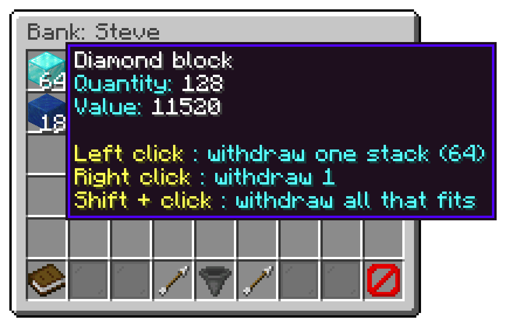
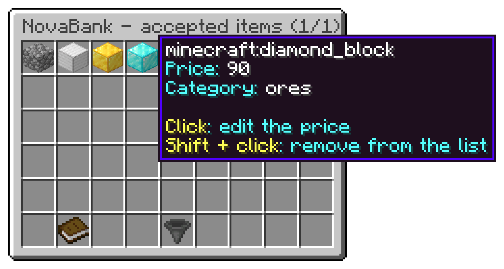
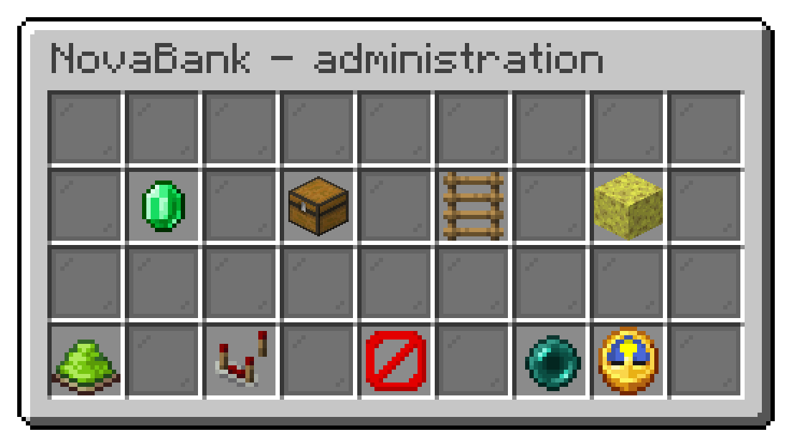
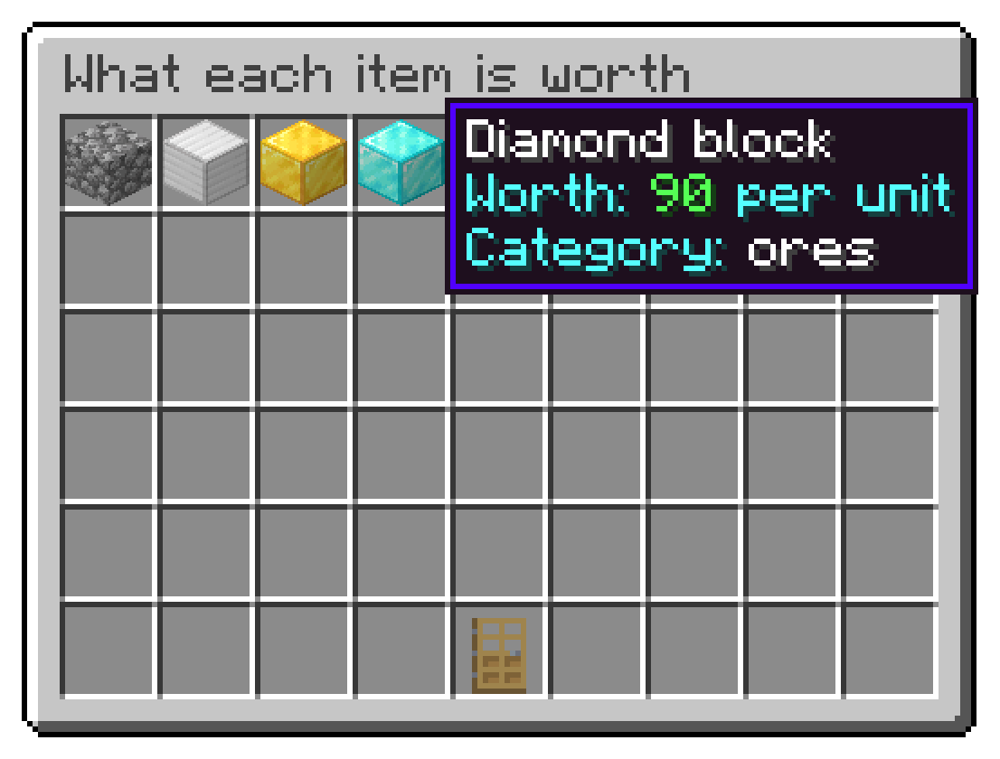

# NovaBank

A virtual **block bank** for Minecraft servers. Players deposit the items the server accepts, withdraw them whenever
they want, and build up a **value** for their own bank or for the bank of their island, town, clan, land, claim or
region. Leaderboards, a chest menu, a full in-game administration menu and a public API are included.

Free and open source, under the [MIT licence](LICENSE).

<p align="center">
  
  
</p>
<p align="center">
  
  
</p>

## Features

- **Banks per entity**: player, island (SuperiorSkyblock2, BentoBox, IridiumSkyblock), town (Towny), clan
  (SimpleClans), land (Lands), claim (GriefPrevention), region (WorldGuard), and any type provided through the API.
- **Safe by design**: idempotent operation log, withdrawals reserved in the database before items are handed over,
  delayed delivery, inventory saved after each operation. No item duplication on crash, disconnection or outage.
- **Six storages**: YAML, JSON, SQLite, MySQL, MariaDB, MongoDB, with in-game migration between them.
- **Multi-server**: shared database as the reference, Redis as an accelerator.
- **Custom items**: ItemsAdder, Nexo, Oraxen, CraftEngine, MMOItems.
- **Island level**: the bank value can be added to the SuperiorSkyblock2 or BentoBox island level.
- **In-game administration**: items and prices, bank menu layout, every `config.yml` setting (secrets included),
  backup before each change, deployment to every server.
- **Discord channel** for deposits and withdrawals (webhook or bot), **PlaceholderAPI** placeholders.
- **French and English** messages, console and `config.yml` comments.
- **Extensions per host plugin**: the bank command lives inside the host (`/is bank`, `/town bank`...), rights are
  set in the host (island privileges, flags, rank permissions).

## Compatibility

Paper, Spigot and Folia, **Minecraft 1.17 to 26.x** (Java 17 bytecode). Your server's own Java version is enough.

## Download and documentation

Each [release](https://github.com/YoannFm/NovaBank/releases) provides:

- `NovaBank-EXTRACT-ME.zip`: **everything in one download** (extract it first; the latest one is always at
  <https://github.com/YoannFm/NovaBank/releases/latest/download/NovaBank-EXTRACT-ME.zip>), sorted by use (standalone plugin, one folder per
  host extension, API), with a README explaining which file to install, the licence and the documentation;
- `NovaBank-<version>.jar`: the standalone plugin, to drop into `plugins/`;
- `NovaBank-<Host>-<version>.jar`: the same plugin packaged as an extension of one host plugin (SuperiorSkyblock2
  module, BentoBox addon, or companion plugin for IridiumSkyblock, Towny, SimpleClans, Lands, GriefPrevention,
  WorldGuard). Install **one** of them per host;
- `NovaBank - Documentation complete.pdf`: the full documentation, in French and English (installation,
  configuration, administration, integrations, API, troubleshooting).

Support: [Discord](https://discord.gg/HtjPAfqUXu).

## Building

Requirements: **JDK 25** (the build tool; the produced bytecode targets Java 17) and **Maven 3.9** or later.

```bash
mvn -B install
```

The first build downloads the dependencies, including the public APIs of the host plugins. The files to publish are
gathered in `dist/`:

- `NovaBank-<version>.jar`: standalone plugin;
- `NovaBank-<Host>-<version>.jar`: extensions per host plugin;
- `novabank-api-<version>.jar`: API, for plugin developers.

`dist/` also holds `NovaBank-EXTRACT-ME.zip`, the organised archive (with `docs/NovaBank - Documentation complete.pdf`
when present). `mvn clean` empties `dist/`. The other JARs in the modules' `target/` folders are intermediate artefacts: never install
them on a server.

Tests that need a real database server (MariaDB, MySQL, MongoDB, Redis) are skipped unless one is provided; see
[CONTRIBUTING.md](CONTRIBUTING.md).

## Project layout

| Module | Role |
|---|---|
| `novabank-api` | public API (`NovaBankApi`, events, `OwnershipProvider`), depends on the Bukkit API only |
| `novabank-core` | business rules: banks, operation log, valuation, deposit and withdrawal flows (no Bukkit) |
| `novabank-config` | `config.yml` parsing, validation and migration |
| `novabank-storage-sql`, `-mongo`, `-file` | storages |
| `novabank-sync-redis` | multi-server synchronisation |
| `novabank-libraries` | database drivers downloaded at runtime, checked by SHA-256 |
| `novabank-bukkit` | Bukkit layer: commands, menus, integrations, Discord, lifecycle |
| `novabank-platform-folia` | Folia scheduler |
| `novabank-plugin` | final standalone JAR |
| `novabank-host-*`, `novabank-editions` | entry points and JARs of the extensions per host plugin |

## Developer API

The API is not published on a public Maven repository yet: run `mvn -B install` in this repository (or install the
`novabank-api` JAR of a release with `mvn install:install-file`), then declare it:

```xml
<dependency>
  <groupId>dev.novadev.novabank</groupId>
  <artifactId>novabank-api</artifactId>
  <version><!-- NovaBank version --></version>
  <scope>provided</scope>
</dependency>
```

Get it through the Bukkit services manager (`NovaBankApi`). Details in the *Developer API* chapter of the
documentation.

## Contributing

Bug reports, ideas and pull requests are welcome: read [CONTRIBUTING.md](CONTRIBUTING.md). The code comments are
written in French; contributions in English are welcome.

## Licence

[MIT](LICENSE) - Copyright (c) 2026 NovaDev (YoannFM).
